<div align="center">

# ClientScout AI

### Your Personal Freelance Intelligence Workspace

A local-first workspace for organizing leads, reviewing website evidence, and preparing thoughtful, human-reviewed outreach.

**Under Active Development · Single-user local application**

**React · TypeScript · FastAPI · SQLAlchemy · SQLite**

[Product experience](#the-workspace) · [Architecture](#architecture) · [Run locally](#local-development) · [Development status](#development-status)

</div>

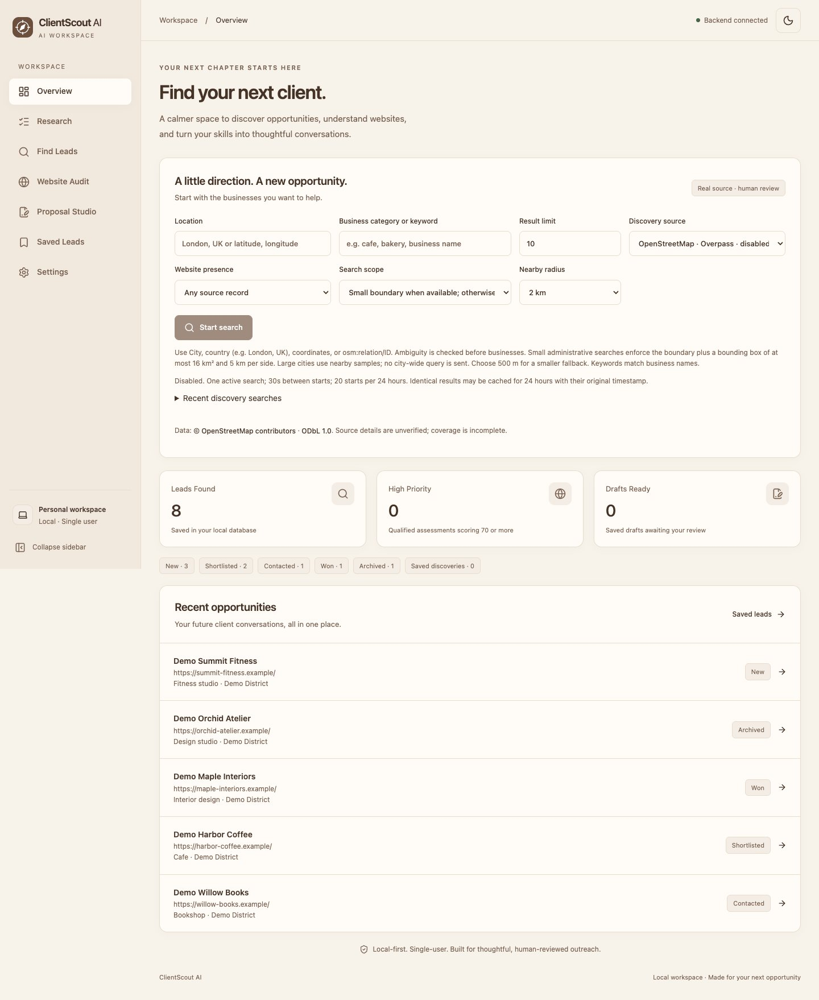

> **Development snapshot — 20 October 2026.** This is an evolving application, not a finished or production-ready service. The published `feature/checkpoint-5` source contains the Checkpoint 5.1 foundation. Local Checkpoint 5.2A/5.2B development remains uncommitted and is described separately below; this documentation update does not publish that application code.

## The vision

Freelance prospecting often fragments into spreadsheets, website checks, bookmarks, and draft messages. ClientScout AI brings those steps into one focused workspace while keeping the difference between supplied information, observed evidence, and unknown facts visible.

The current product emphasizes deliberate actions: save a lead, review a permitted source, inspect an assessment, and approve a draft before using it. Its longer-term research direction builds on that foundation; autonomous prospecting is not presented as an operational capability.

## The workspace

| Area | Implemented experience | Evidence |
| --- | --- | --- |
| Overview | Database-backed lead totals, status counts, recent opportunities, qualified high-priority counts, and saved-draft readiness | [Workspace](frontend/src/pages/Workspace.tsx), [dashboard API](backend/app/api/leads.py) |
| Lead management | Add, edit, delete, search, filter, paginate, and review manual/CSV leads with persistent statuses and notes | [Leads UI](frontend/src/pages/Leads.tsx), [lead API](backend/app/api/leads.py) |
| Import | URL normalization and hostname deduplication; bounded UTF-8 CSV parsing with created/duplicate/invalid row outcomes | [Import component](frontend/src/components/CsvImport.tsx), [parser](backend/app/services/imports.py) |
| Website audit | Explicitly requested static website observations, evidence, recommendations, persisted job history, and optional PageSpeed measurements | [Audit page](frontend/src/pages/WebsiteAudit.tsx), [audit runner](backend/app/auditing/runner.py) |
| Business discovery | Bounded OpenStreetMap/Overpass searches, persisted history/cache, attribution, and deliberate selected-record saving | [Discovery UI](frontend/src/components/Discovery.tsx), [provider](backend/app/providers/overpass.py) |
| Lead intelligence | Bounded public business-contact enrichment, identity review, explainable assessments, and advanced filters | [Intelligence UI](frontend/src/components/LeadIntelligence.tsx), [scoring](backend/app/intelligence/scoring.py) |
| Proposal Studio | Editable local templates; optional backend-only Gemini writing; saved-text review acknowledgement before new-mode drafts are ready for manual outreach | [Proposal Studio](frontend/src/pages/ProposalStudio.tsx), [writer policy](docs/option-a-human-reviewed-writer.md) |
| Research foundation | Immutable plan revisions, paused-by-default jobs, explicit offline checks, persistent progress/activity, and versioned controls | [Research manager](backend/app/research/manager.py), [foundation notes](docs/checkpoint-5-1-foundation.md) |
| Preferences | Persistent light/dark/system themes, collapsible desktop sidebar, mobile navigation, and backend health checks | [Application shell](frontend/src/App.tsx), [theme hook](frontend/src/hooks/useTheme.ts) |

These implementations were inspected in source and exercised through isolated automated checks. External discovery, website fetching, PageSpeed, and Gemini were **not** called during this audit; passing mocked tests is not live-provider verification.

### A clear home for leads

The lifecycle is **New → Shortlisted → Contacted → Won**, with **Archived** available as a separate status. These are editable user-recorded states, not an enforced sales sequence. Choosing Contacted does not send a message, and choosing Won does not establish a verified business result.

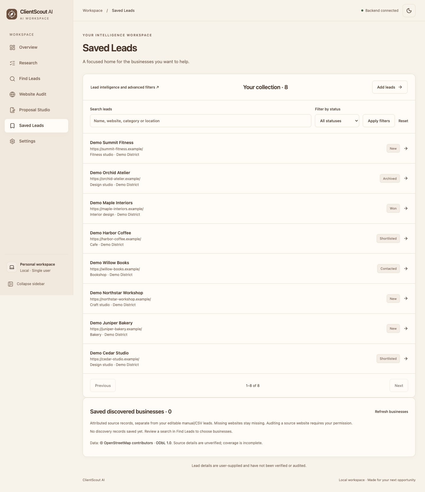

Details keep the editable lead and its research context together. Imports preserve existing records rather than silently overwriting them; OpenStreetMap discoveries remain a separately attributed collection rather than being automatically merged into private leads.

<details>
<summary>View the lead detail screen</summary>

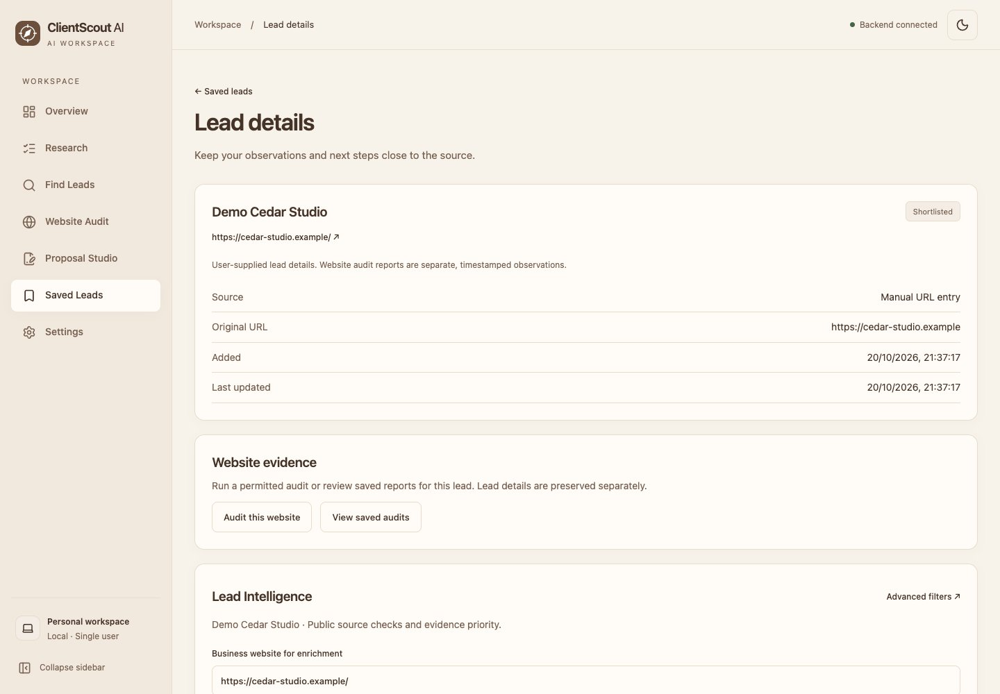

</details>

### Evidence before priority

Assessments distinguish evidence coverage from priority. Missing observations remain unknown; they are not converted into invented problems, contact details, or sales predictions. Official website association and qualifying evidence are required before a numeric priority is treated as qualified.

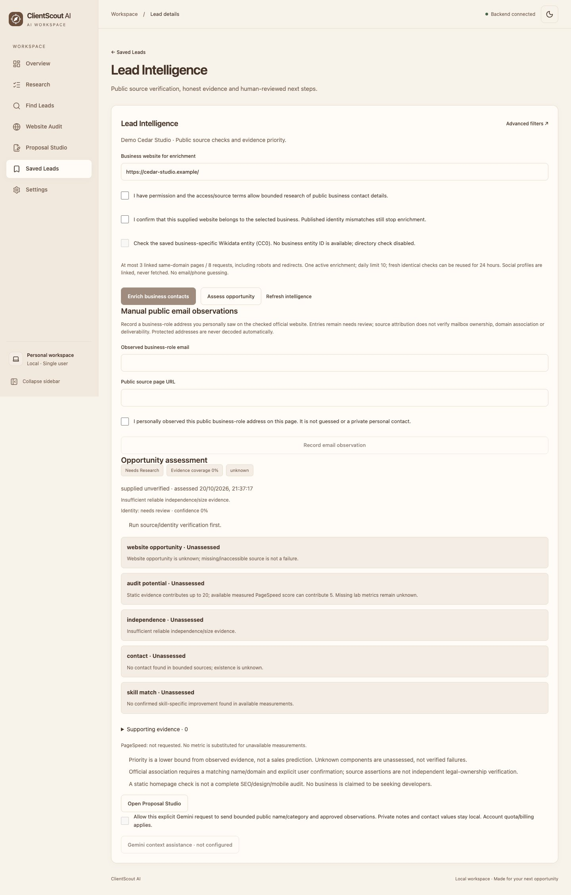

The demonstration assessment is calculated by the real local scoring code from synthetic records. No website findings, contacts, successful audits, or AI outputs were fabricated to populate the screenshots.

### Import and discovery are separate workflows

**Manual URL / CSV import** uses user-supplied records and does not fetch those websites. CSV input supports a required `website_url` header and optional `business_name`, `category`, `location`, `status`, and `notes` columns. Limits are 1 MiB and 500 rows; valid rows save together, while duplicates and invalid rows are reported.

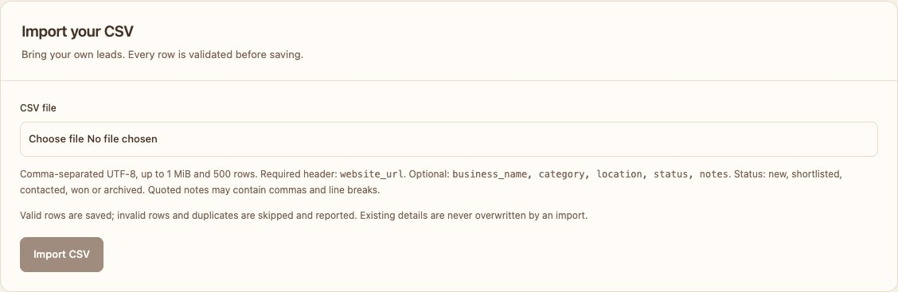

**Discovery** is a separate, explicitly started backend workflow. It supports bounded locations/coordinates, categories or literal keywords, result limits, website-tag filters, persisted progress, cancellation, and source review. It is not an exhaustive directory. Missing source website tags do not prove that a business has no website.

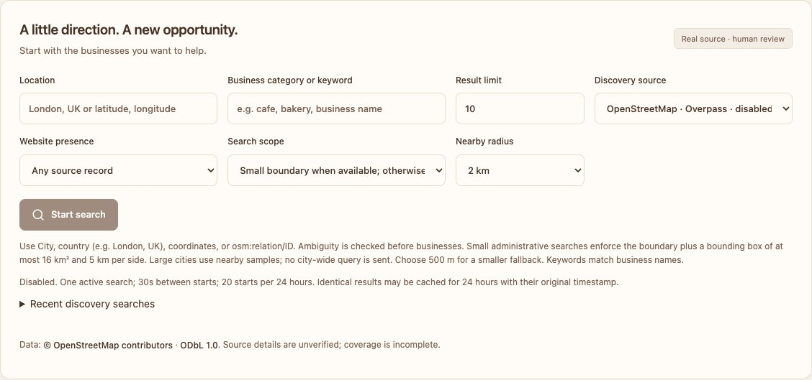

Saving source records requires selection and a licensing acknowledgement. Review [provider bounds, attribution, and ODbL obligations](docs/discovery-provider.md) before enabling discovery or sharing source-derived information.

<details>
<summary>View the website audit interface</summary>

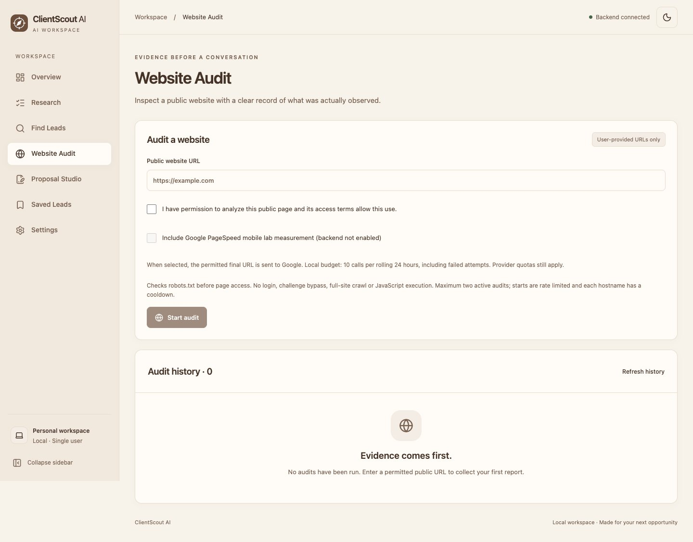

</details>

## Across screens and themes

Cream surfaces, coffee-colored typography, restrained borders, and a compact compass mark give the interface a calm visual identity. CSS variables define light and dark palettes; the theme preference persists in browser storage and can follow the device setting.

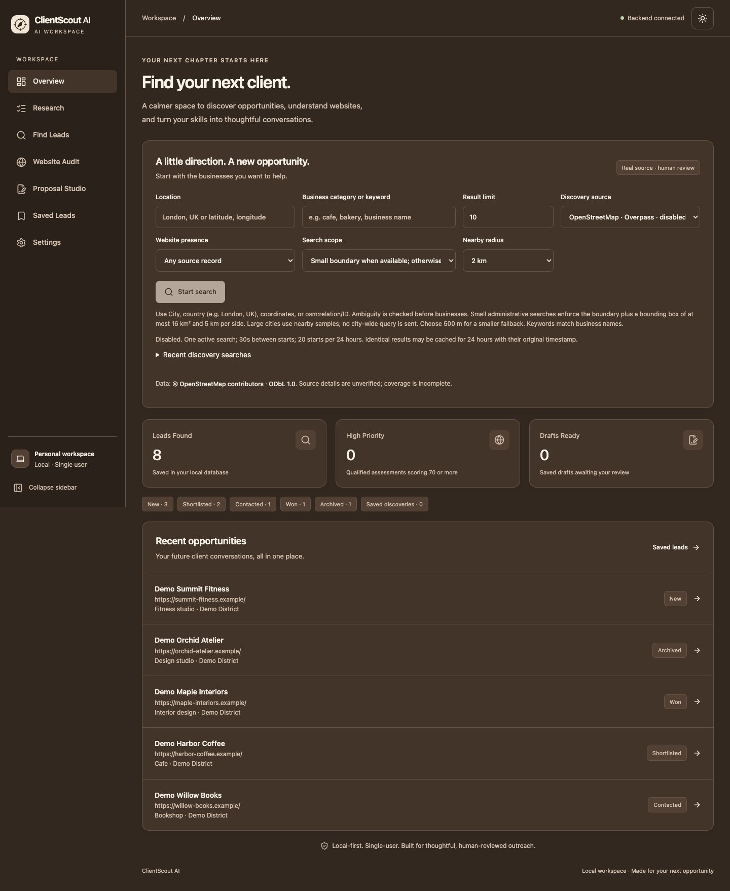

| Tablet dashboard · 768px | Mobile dashboard · 390px |
| --- | --- |
| 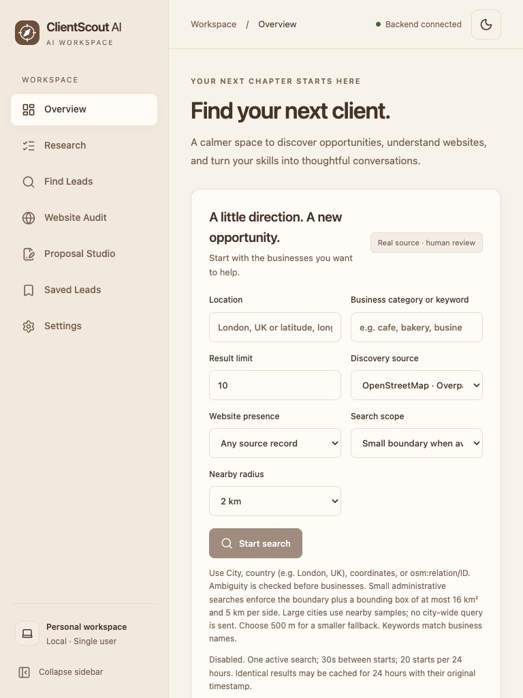 | 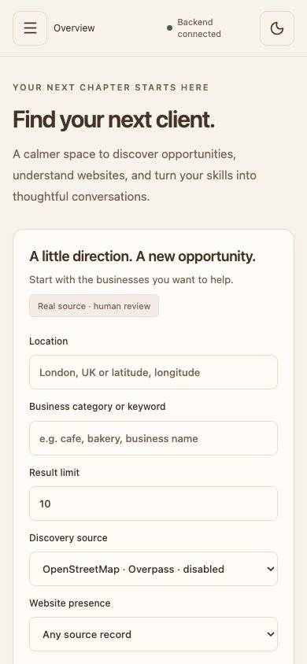 |

<details>
<summary>View mobile navigation and settings</summary>

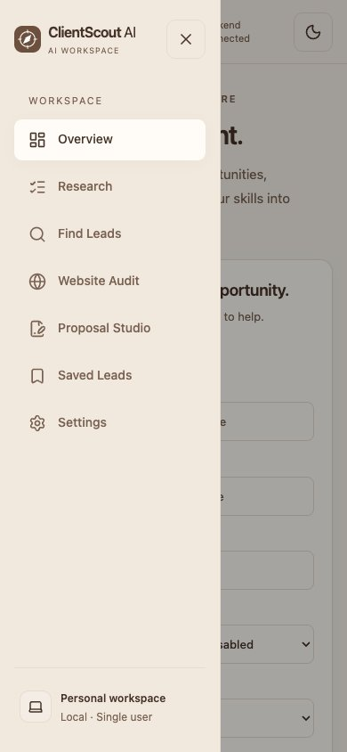

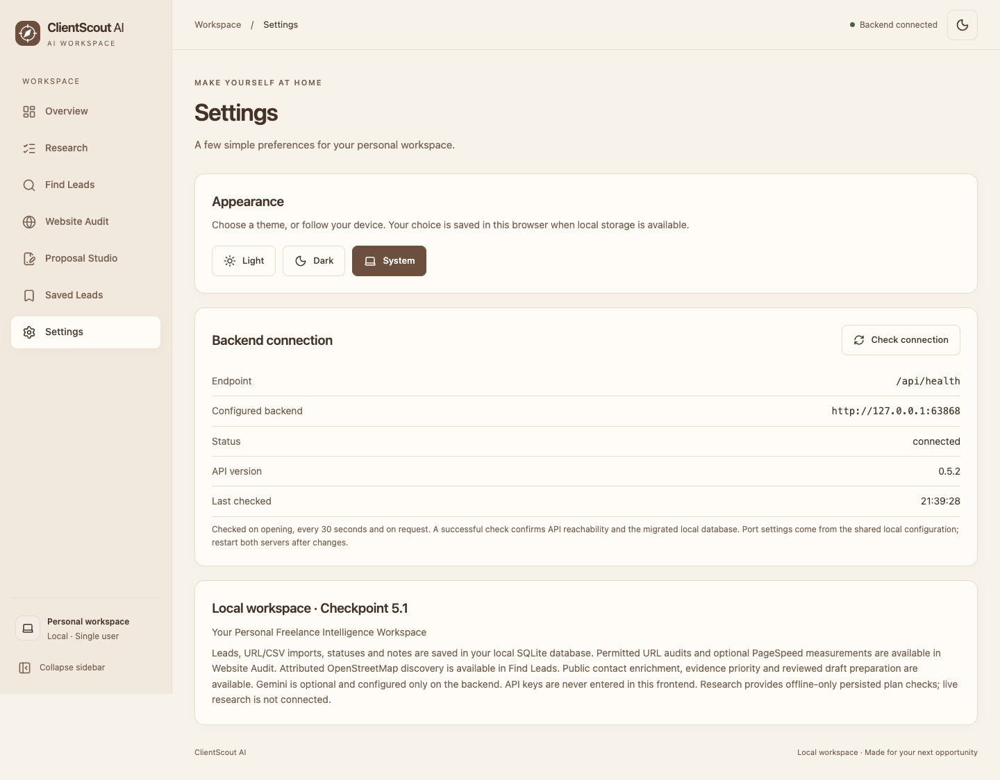

</details>

Screenshots are genuine renders of the **local development working tree**, including pending 5.2 changes. They use a separate temporary SQLite database containing eight clearly fictional `Demo` records on reserved `.example` domains. No real lead database, profile, contact records, emails, phone numbers, private notes, or credentials were copied. Browser mutations and external requests were blocked; backend providers were disabled and outbound connections blocked. Counts and empty/unknown states are actual application results from that synthetic database.

## Architecture

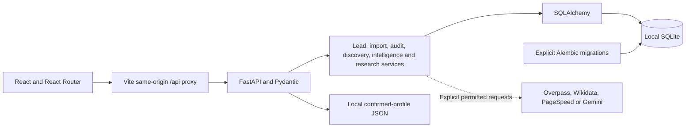

Provider edges describe implemented, separately controlled adapters. They do not mean that the offline Research foundation automatically calls those services.

### Frontend

[React 19](frontend/package.json), TypeScript, and Vite form the application shell. React Router maps pages for Overview, Research, Find Leads, Website Audit, Saved Leads, intelligence details, Proposal Studio, and Settings. Components handle imports, forms, discovery review, evidence, profile editing, and consistent resource states.

The service layer uses typed requests, response validation for resource families, timeouts, and cancellation. Shared hooks handle loading/error states, health polling, themes, and AI-job status. Styling combines Tailwind's Vite integration with application CSS and semantic theme tokens; icons come from Lucide React. Health is checked on opening, every 30 seconds, and on request.

### Backend and API

FastAPI exposes Pydantic-validated routes under `/api`. SQLAlchemy sessions handle persistence; separate managers coordinate audits, discovery, enrichment, AI jobs, and the offline research worker. Job state, usage bounds, cancellation, and recovery are represented explicitly rather than simulated with progress percentages.

| API family | Current responsibility |
| --- | --- |
| `GET /api/health` | API reachability and required migrated-schema checks |
| `/api/dashboard` and `/api/leads` | Workspace totals and lead CRUD/search/pagination |
| `POST /api/imports/csv` | Validated, bounded local CSV import |
| `/api/audits` | Audit configuration, explicit starts, history, read, and cancellation |
| `/api/discovery` | Source configuration, explicit searches, history, cancellation, review-save, and saved records |
| `/api/intelligence` | Targets, contacts/enrichment, assessments/filters, local profile, drafts/review, and optional AI jobs/usage |
| `/api/research` | Offline foundation jobs, worker status, controls, and activity |

Inspect the running local `/docs` for the exact schema of your checkout. Pending local 5.2 adds `/api/research/jobs/{job_id}/discovery` preparation, approval, dispatch, control, events, and results routes; those additions are **not included in this documentation-only commit**.

Network-facing adapters remain backend-only. Audits/enrichment include public-address validation, DNS pinning, TLS verification, redirect and response-size limits, and robots/access checks. Local Host/CORS/Origin restrictions exist, but they do not constitute a multi-user authentication or production isolation system.

### Persistence and migrations

SQLite stores editable leads, audit jobs, source searches/cache and attributed businesses, identities/enrichments, assessments, drafts, AI usage, and research plans/jobs/steps/attempts/events/leases. A confirmed freelancer profile is stored in an ignored JSON file beside the configured database; it is not a browser credential store.

| Migration | Adds |
| --- | --- |
| `0001_leads` | Lead records, source metadata, and uniqueness/status constraints |
| `0002_audits` | Persisted audit jobs and evidence |
| `0003_discovery` | Source searches, cache, and saved discovered businesses |
| `0004_discovery_diagnostics` | Source request diagnostics |
| `0005_intelligence` | Business identities, enrichment, contacts, assessments, drafts, and AI usage |
| `0006_ai_jobs` | Durable AI request/result job fields |
| `0007_research_foundation` | Offline research revisions, jobs, steps, attempts, approvals, events, and worker lease |
| `0008_research_discovery` | **Pending local 5.2 work only:** supervised-discovery execution/grant/request/result/activity tables |

Startup does **not** apply migrations automatically. Committed 5.1 source expects revision `0007_research_foundation` and reports API version `0.5.1`; the audited local 5.2 working tree expects `0008_research_discovery` and reports `0.5.2`. Use migrations that belong to the same checkout. Existing checkpoints record prior authorized migrations; this audit did not inspect, connect to, or migrate the user's actual database.

## Project structure

```text
clientscout-ai/
├── frontend/
│   ├── src/
│   │   ├── pages/             # Workspace, leads, audits, research, proposals
│   │   ├── components/        # Forms, import, discovery, evidence, profile
│   │   ├── services/          # API contracts and validated request helpers
│   │   ├── hooks/             # Resource, theme, health, and AI-job state
│   │   └── themes/            # Light/dark tokens
│   ├── package.json
│   └── vite.config.ts
├── backend/
│   ├── app/
│   │   ├── api/               # FastAPI routers
│   │   ├── core/              # Shared settings
│   │   ├── database/          # SQLAlchemy engine and sessions
│   │   ├── models/            # Persisted application records
│   │   ├── schemas/           # Pydantic request/response contracts
│   │   ├── services/          # URL normalization and CSV parsing
│   │   ├── auditing/          # Bounded public-site checks
│   │   ├── discovery/         # Discovery lifecycle and persistence
│   │   ├── intelligence/      # Identity, assessment, drafts, profile
│   │   ├── providers/         # Explicit external adapters
│   │   └── research/          # Durable offline foundation
│   ├── migrations/versions/
│   ├── tests/
│   └── requirements.txt
├── config/local.json          # Shared default ports
├── docs/                      # Architecture, checkpoints, and screenshots
├── .env.example               # Optional configuration placeholders
├── Makefile                   # Feature checks and full validation
└── README.md
```

## Local development

The audited environment uses **Node 24.19.0, npm 11.17.0, and Python 3.14.7**. Dependency versions are recorded in `frontend/package.json`, its lockfile, and `backend/requirements.txt`. No dependencies were installed during this documentation task.

### Install in a fresh checkout

```sh
git clone --branch feature/checkpoint-5 https://github.com/sahilbhardwaj037037-sys/clientscout-ai.git
cd clientscout-ai
python3 -m venv backend/.venv
backend/.venv/bin/python -m pip install -r backend/requirements.txt
(cd frontend && npm ci)
```

The installation commands above are instructions for a new development environment. They were not executed against the active project. Do not replace an existing checkout or overwrite its `.env`, database, profile, or ongoing changes.

### Start with a separate development database

From the root of that fresh checkout, in the backend terminal:

```sh
# Create an unused directory; no existing database is selected.
CLIENTSCOUT_PREVIEW_DIR="$(mktemp -d "${TMPDIR:-/tmp}/clientscout-preview.XXXXXX")"
export CLIENTSCOUT_DB_PATH="$CLIENTSCOUT_PREVIEW_DIR/clientscout-preview.sqlite3"
export DISCOVERY_ENABLED=false PAGESPEED_ENABLED=false
export GEMINI_API_KEY= PAGESPEED_API_KEY=
(cd backend && .venv/bin/python -m alembic upgrade head)
(cd backend && .venv/bin/python -m app.run)
```

In a second terminal, from the same fresh checkout:

```sh
cd frontend
npm run dev
```

With default settings, open **http://127.0.0.1:5173/**. Health is **http://127.0.0.1:8000/api/health** and the API reference is **http://127.0.0.1:8000/docs**. Stop either process with `Ctrl+C`. The application starts empty; screenshot records are temporary demonstration data and are not shipped as a seed dataset.

This disables discovery, PageSpeed, and Gemini. Website audit/contact enrichment still require external access if deliberately invoked: do not start them during an offline review. The capture environment additionally blocked outbound connections, which these ordinary launch commands do not do.

### Configuration

Precedence is **process environment → optional root `.env` → `config/local.json` defaults**. The frontend uses same-origin `/api` requests through Vite's configured proxy; do not add a separate frontend API base URL. Restart both servers after changing shared ports.

| Variable | Purpose / default |
| --- | --- |
| `CLIENTSCOUT_API_PORT` | Backend port; default `8000` |
| `CLIENTSCOUT_FRONTEND_PORT` | Vite port; default `5173`; preview uses this value plus one |
| `CLIENTSCOUT_DB_PATH` | SQLite file; defaults to ignored `backend/data/clientscout.db`; relative paths resolve from the repository root |
| `DISCOVERY_ENABLED` | Defaults to `true`; set `false` for local review without source searches |
| `OVERPASS_API_URL` | Permitted HTTPS Overpass endpoint; defaults to the configured public operator |
| `PAGESPEED_ENABLED`, `PAGESPEED_API_KEY`, `PAGESPEED_DAILY_LIMIT` | Optional backend PageSpeed adapter; daily limit defaults to `10` |
| `GEMINI_API_KEY`, `GEMINI_MODEL`, `GEMINI_DAILY_LIMIT` | Optional backend AI adapter; model defaults to `gemini-3.5-flash-lite`, daily limit `10` |

An empty Gemini key disables live AI. PageSpeed's empty enabled flag follows key presence; use explicit `false` to disable it. Keep keys backend-only and out of screenshots, commits, and logs. See [.env.example](.env.example) for the complete current settings.

## Safe validation

The [Makefile](Makefile) defines full and feature-focused checks. From a fresh checkout with installed dependencies, use an isolated fallback database and empty provider credentials:

```sh
CLIENTSCOUT_TEST_DIR="$(mktemp -d "${TMPDIR:-/tmp}/clientscout-tests.XXXXXX")"
CLIENTSCOUT_DB_PATH="$CLIENTSCOUT_TEST_DIR/fallback.sqlite3" \
  DISCOVERY_ENABLED=true PAGESPEED_ENABLED=false \
  GEMINI_API_KEY= PAGESPEED_API_KEY= make check
```

`DISCOVERY_ENABLED=true` here is **test-process configuration** so mocked discovery paths can be exercised. It is not an instruction to enable a running workspace or start live searches. Backend fixtures use separate migrated temporary databases and mocked transports; the suite blocks live Gemini calls. This audit additionally blocked backend outbound sockets and denied access to the original project.

| Command | Responsibility |
| --- | --- |
| `make test-backend` | Pytest backend suite |
| `make test-frontend` | Vitest / Testing Library suite |
| `make test-leads`, `make test-audits`, `make test-discovery` | Focused workflow checks |
| `make test-intelligence`, `make test-shell`, `make test-security` | Focused intelligence, shell, and boundary checks |
| `make check` | Backend tests, frontend tests, TypeScript checking, and Vite build |
| `cd frontend && npm run preview` | Local built-app preview with the API proxy; requires the backend |

For individual test targets, apply the same isolated database and provider environment as above. No lint script is configured; the build's `tsc -b` performs TypeScript checking.

**Audit results:** 665 backend tests passed with two third-party deprecation warnings; 92 frontend tests passed in nine files; TypeScript/Vite build passed. These counts describe the **local working tree including uncommitted 5.2 tests**, not the test count of a fresh 5.1 checkout. Browser checks covered 1440px, 768px, 390px, and 320px with the temporary synthetic database. No live-provider, paid-AI, outreach, production, or real-data acceptance was performed.

## Development status

| State | Verified boundary |
| --- | --- |
| **Implemented in the tracked branch** | Checkpoints 1–4 lead/import/audit/discovery/intelligence/draft functionality, plus the 5.1 durable offline research foundation |
| **Implemented locally; pending integration** | 5.2A supervised-discovery infrastructure and migration 0008; 5.2B separate preparation/approval/dispatch controls, source-evidence classification, and persistent save receipts. Local automated tests cover these additions; their code and checkpoint notes remain uncommitted and are not published by this task. |
| **Needs separate live acceptance** | Provider availability, supervised-discovery dispatch, genuine active-process crash/pause timing, and current end-to-end external AI delivery; mocked tests do not establish these outcomes |
| **Proposed / deferred** | Broader E2E, performance/accessibility/security review and CSV export appear in earlier planning notes. They are not claimed complete; older checklists also contain superseded checkpoint status. |
| **Not currently operational** | Scheduled autonomous research, notifications, automatic outreach, cloud sync, and a production multi-user service |

The next development step is review and integration of the pending 5.2 work under its existing approval and data-protection boundaries. This documentation task does not change the roadmap, enable providers, or implement later checkpoints. No release dates or completion percentage are asserted. APIs, schemas, UI, and workflows may change as development continues.

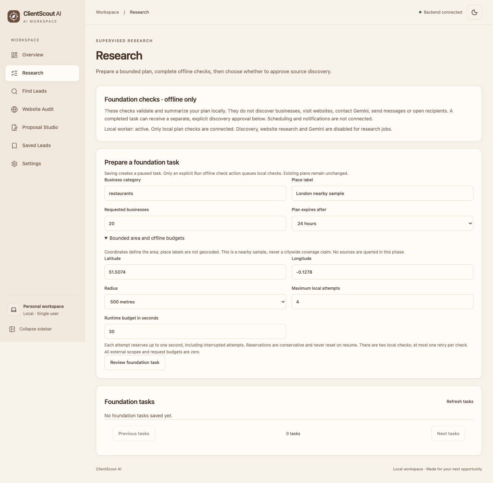

**Deployment:** local frontend/backend operation was verified in an isolated development environment. No public deployment was verified, and no deployment configuration or workflow is tracked in the audited repository. A successful frontend build is not evidence of a deployed or production-ready service.

## Development-stage boundaries

This is a loopback-bound, single-user workspace. Use one backend worker; existing managers are not a production multi-worker architecture. Source coverage can be partial, assessments are not predictions, and AI prose remains factually unverified even after human acknowledgement. No email, direct message, contact form, or business communication is sent automatically.

Sensitive runtime files belong outside Git. The audit found no tracked `.env`, local database, private-key files, or recognized credential patterns in the tracked source. That focused review is not a complete vulnerability audit or a guarantee of all dependency security. Original databases, profile, migrations, configuration, and pending development were preserved.

## Credits and licensing

- Repository: [sahilbhardwaj037037-sys/clientscout-ai](https://github.com/sahilbhardwaj037037-sys/clientscout-ai).
- OpenStreetMap source records require **© OpenStreetMap contributors** attribution and carry **ODbL 1.0** obligations. See [OpenStreetMap copyright](https://www.openstreetmap.org/copyright), [ODbL](https://opendatacommons.org/licenses/odbl/1-0/), and the repository's [provider policy](docs/discovery-provider.md). Do not publish a workspace database or private lead notes as part of a portfolio.
- Optional Wikidata observations retain **CC0** provenance. Their presence does not independently verify a business's website or identity.
- The UI uses React, React Router, Tailwind CSS, and Lucide React; the backend uses FastAPI, Pydantic, SQLAlchemy, Alembic, and optional provider libraries. Dependency licensing remains governed by each dependency's own terms.
- Screenshots show this application's actual UI with synthetic local records; they contain no generated mockups or fabricated provider results. Existing historical screenshots and checkpoint documents were preserved.
- No root `LICENSE` file is present. No permissive project-code license, asset ownership, or third-party reuse permission is asserted by this README.
